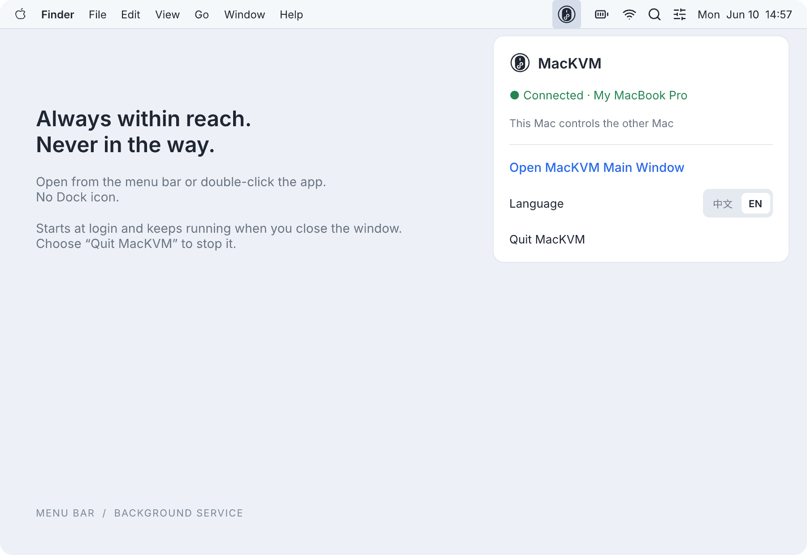
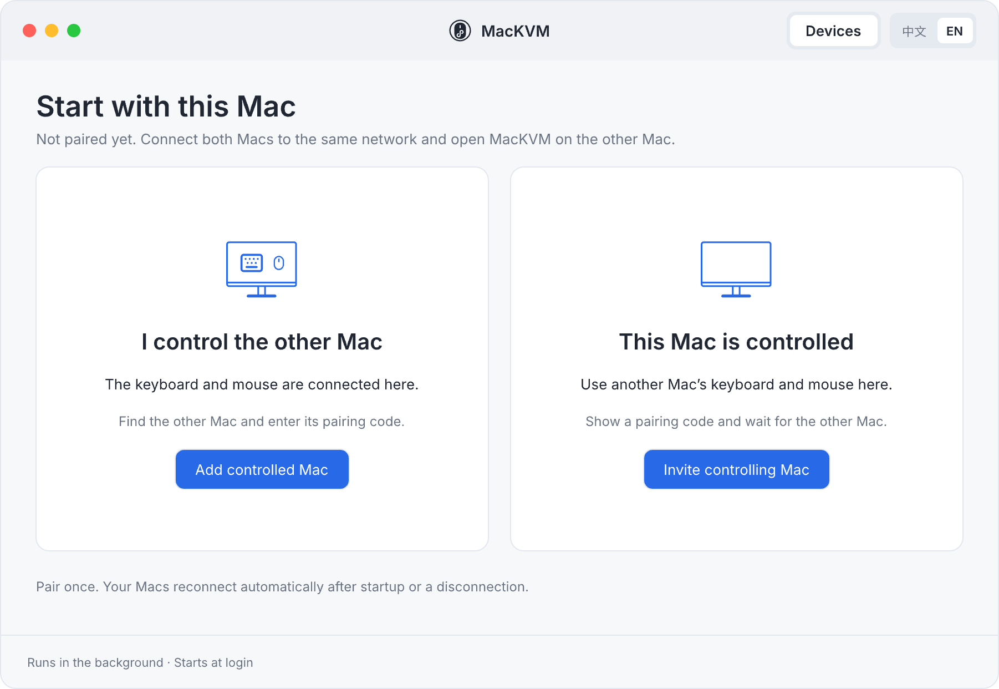
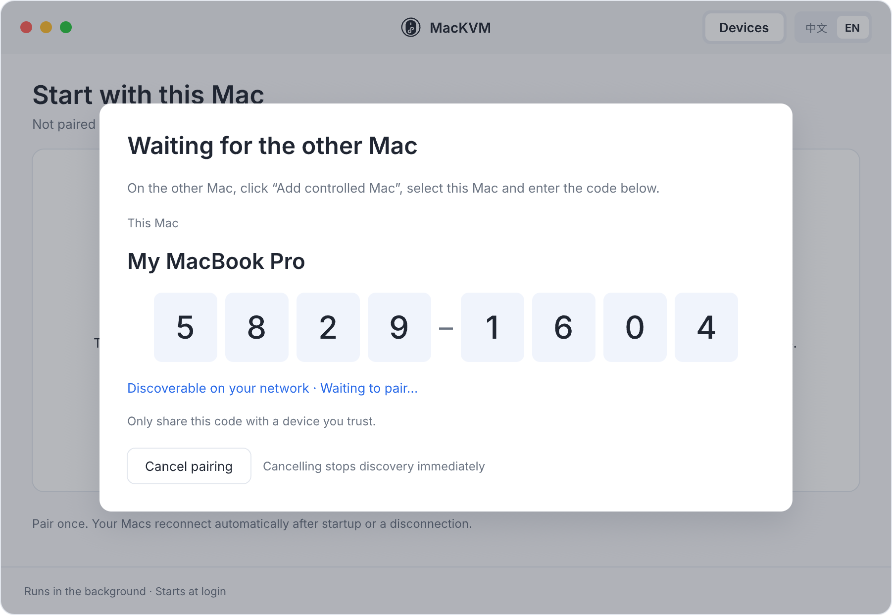
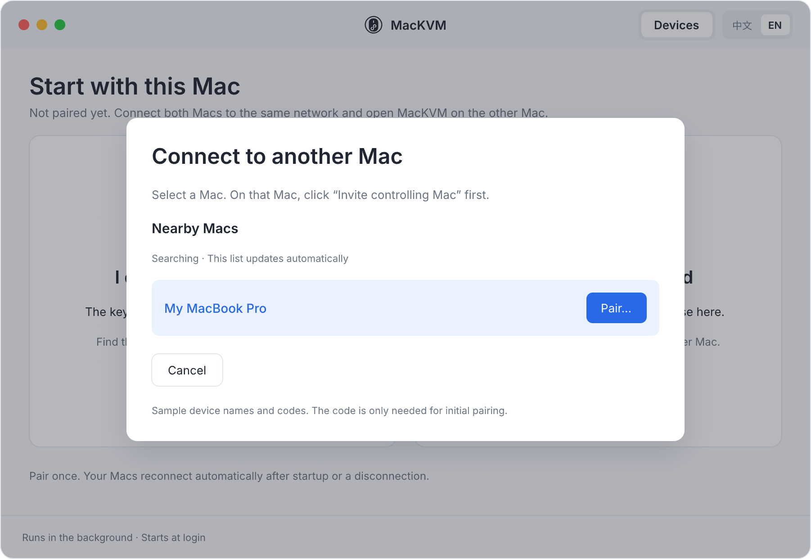
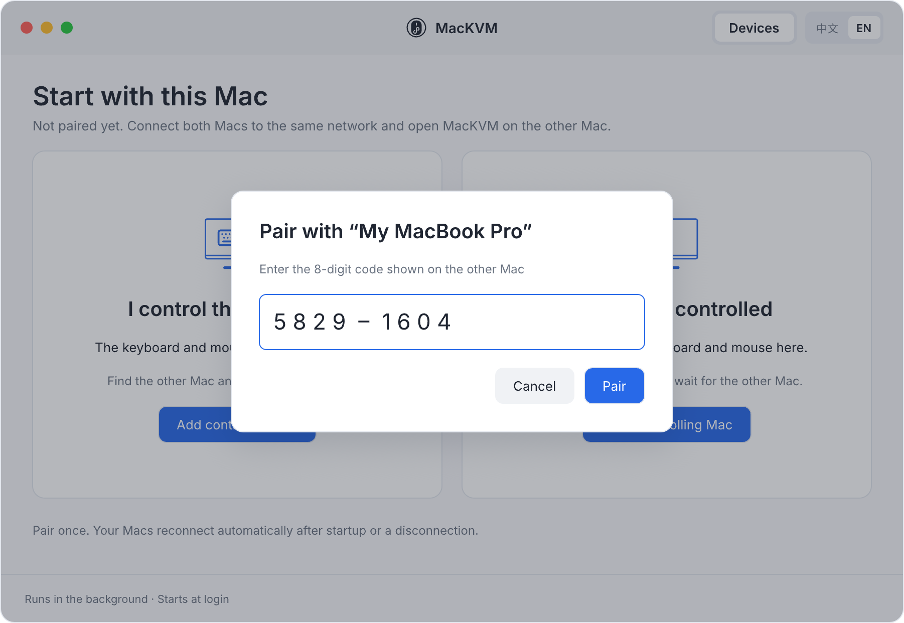
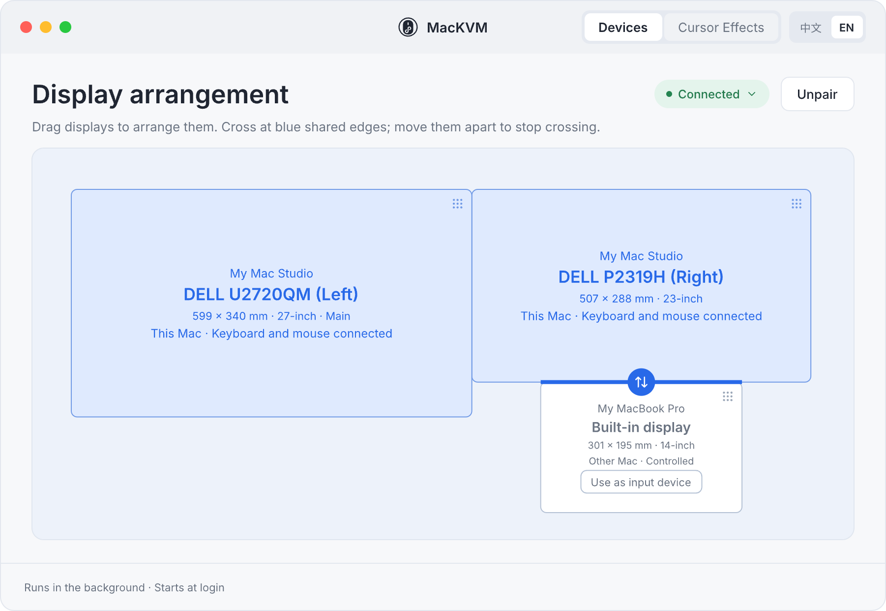
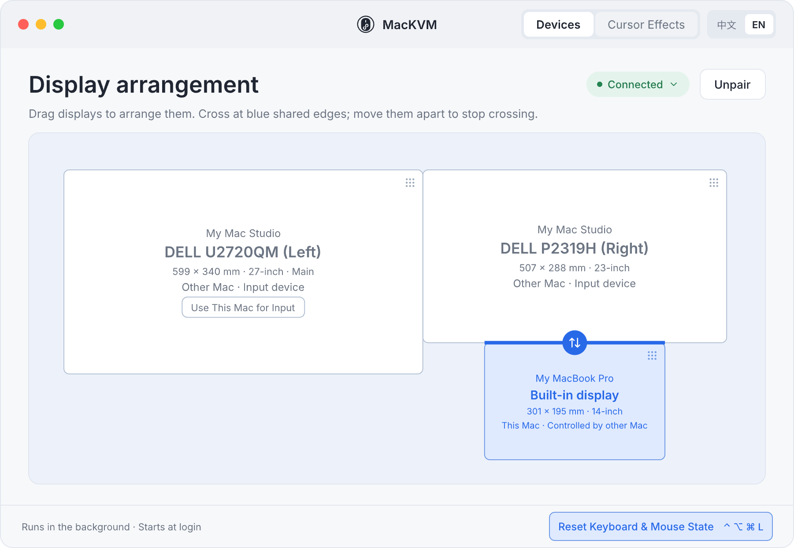
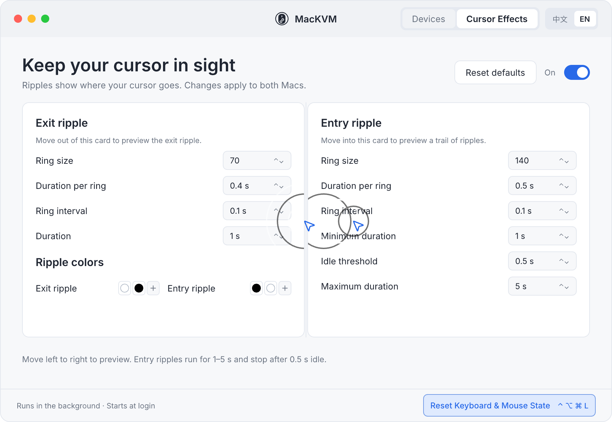
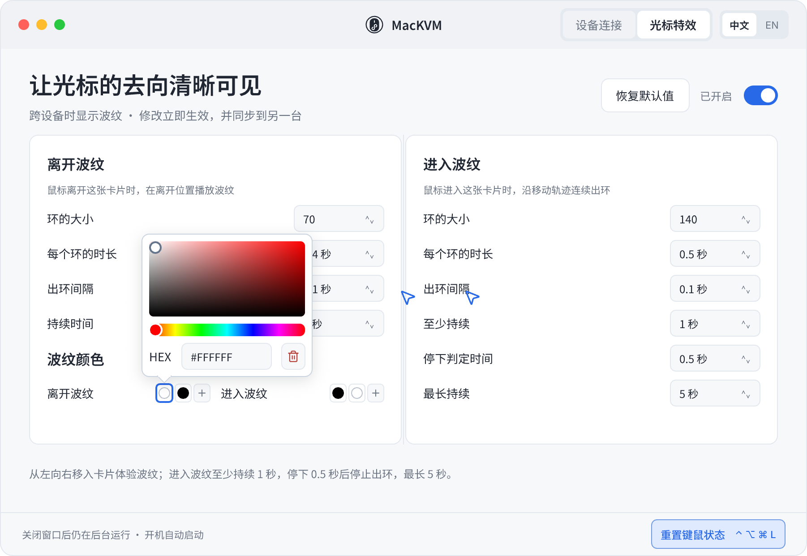

# MacKVM

One keyboard and mouse, two Macs. Plug them into one Mac, push the cursor across a screen edge, and input follows
to the other Mac. It does this one thing, for two Macs only, with no third-party dependencies, and the source fits
in an afternoon of reading.

**中文：** see [README.md](README.md). Comments and logs in the source are in Chinese.

## What it does

- One Mac is the controller (the keyboard and mouse are connected to it); the other is controlled. Roles can be swapped from the UI.
- On the Devices page you arrange both Macs' displays side by side. Wherever one of your displays touches one of the
  other Mac's displays, the cursor can cross in both directions; move them apart and it can't.
  Positions are matched by physical size (millimetres), independent of resolution and scaling. Each Mac can have any number of displays.
- When the cursor crosses, a ripple plays where it left and where it arrived. The style is adjustable and synced between the Macs.
- Pairing uses an 8-digit code on the local network; after that the Macs find each other and reconnect automatically.
- Reset keyboard & mouse state: press Ctrl+Option+Cmd+L at any time to hand the cursor and keyboard back to the controller. If the cursor gets stuck on the controlled Mac, you can also click "Reset Keyboard & Mouse State" in its main window.
- The interface is available in Chinese and English: switch any time with the 中文 / EN toggle in the title bar or the menu bar menu.
  It takes effect immediately and follows the system language by default.

Not planned: Windows / Linux, more than two Macs, clipboard sync, file drag-and-drop.

## Requirements

- Two Apple silicon Macs running macOS 26 or later.
- Both on the same local network, able to discover each other's Bonjour services.
- Accessibility permission for MacKVM on each Mac (System Settings → Privacy & Security → Accessibility). You are prompted on first launch.
- Xcode command line tools (`swiftc`) to build.

## Install

On each Mac:

```bash
git clone https://github.com/leo4stone/mackvm.git
cd mackvm
./build.sh          # build, sign, install to ~/Applications/MacKVM.app
./install-agent.sh  # install as a login LaunchAgent and start it
```

Then:

1. System Settings → Privacy & Security → Accessibility: turn on MacKVM. The first launch prompts for it; the app continues on its own once granted.
2. The first time it touches the local network, macOS asks to allow finding local network devices. Allow it.
3. Pair the two Macs as described below.

If MacKVM cannot be added to the Accessibility list with "+" (this usually happens after the bundle identifier changed
or MacKVM.app was moved), a stale Launch Services record is in the way. Re-register the app and restart it; no reboot needed:

```bash
/System/Library/Frameworks/CoreServices.framework/Frameworks/LaunchServices.framework/Support/lsregister -f ~/Applications/MacKVM.app
launchctl kickstart -k gui/$(id -u)/io.github.leo4stone.mackvm
```

Logs are in `~/Library/Logs/MacKVM.log`. Pairing state and the long-term key are in `~/Library/Application Support/MacKVM/state.json`.
To uninstall: `launchctl bootout gui/$(id -u)/io.github.leo4stone.mackvm`, then delete `~/Applications/MacKVM.app` and the two paths above.

## How to use

The screenshots below are exported from the design files and match the app. Device names are examples.

### The menu bar

Once installed, MacKVM lives only in the menu bar; there is no Dock icon. Click the icon to open the main window;
right-click (or Control-click) it for the menu, which shows the connection status and lets you open the main window,
reset keyboard & mouse state (on the controlled Mac only), switch language, and quit. Closing the main window keeps the app running in the
background, and it starts at login. Choose "Quit MacKVM" to stop it.



### Step 1: choose this Mac's role

Open the main window on both Macs. The Mac with the keyboard and mouse is the controller: click "Add controlled Mac".
The other Mac is controlled: click "Invite controlling Mac". Start with the controlled Mac.



### Step 2: pair

After clicking "Invite controlling Mac", the controlled Mac shows an 8-digit pairing code and announces itself on the local network.



On the controller, click "Add controlled Mac". The inviting Mac appears in the list; click "Pair".



Enter the 8-digit code shown on the controlled Mac. After 5 wrong attempts the other Mac issues a new code.



You pair once. After that both Macs reconnect automatically after startup or a disconnection; no code is needed again.
The code is only used for the initial verification; later connections are encrypted with a key derived during pairing.

### Step 3: arrange the displays

After pairing you land on the Devices page. The preview shows every display of both Macs, drawn to scale by physical size.
This Mac's displays are blue; the other Mac's are white. Every display can be dragged. It snaps to nearby displays, and
displays cannot overlap.

Where one of this Mac's displays touches one of the other Mac's displays, that edge segment turns blue. Push the cursor
out through it to switch to the other Mac, and push back through the opposite side to return. Move the displays apart
and the cursor can no longer cross. The arrangement is synced to both Macs and takes effect immediately.



When pairing completes, a default arrangement is created: the other Mac's display goes to the right of this Mac's
rightmost display, centred. This arrangement only decides how the cursor crosses; it is independent of the display
arrangement in macOS.

"Use as input device" on the other Mac's display swaps the roles: after confirming, connect the keyboard and mouse to
that Mac. "Unpair" in the header returns both Macs to the unpaired state.

### Crossing and resetting keyboard & mouse state

- Push the cursor through a blue edge segment to switch to the other Mac; keyboard input follows. Push back to return.
- The cursor does not cross while a mouse button is held down (dragging). This is intentional.
- Press **Ctrl + Option + Cmd + L** at any time to reset keyboard & mouse state and hand the cursor and keyboard back to the controller, for example when the other Mac freezes or drops off the network.
  If the cursor gets stuck on the controlled Mac, you can also click "Reset Keyboard & Mouse State" at the bottom of its main window, or press the hotkey on its own keyboard.
  After a reset, the cursor returns to the center of the controller's main display (the one with the menu bar).
- When the other Mac is offline you can still rearrange displays; the change syncs when it reconnects.

The Devices page as seen on the controlled Mac: its own display is blue, and the reset button sits at the bottom right.



### Cursor effects

The Cursor Effects page tunes the ripples shown when the cursor crosses: one ring where it leaves, and a trail of rings
along its path where it arrives. Size, duration, interval, and colours are adjustable; changes apply immediately and sync
to the other Mac. Move the mouse between the two cards to preview. Turning the main switch off hides the ripples and does
not affect keyboard and mouse sharing.



Click any colour swatch to open the picker; dragging the colour field or hue bar, or typing a HEX value, applies immediately.
Click outside, or click the same swatch again, to close. The delete button in the popover removes that colour (each group keeps at least one); right-clicking a swatch also removes it, and "+" adds one.



### Switching language

The 中文 / EN toggle is in the title bar and in the menu bar menu. One click switches immediately, no restart. The default
follows the system language; once you switch manually the choice is remembered on this Mac only.

## About code signing (read this first)

`build.sh` signs with an ad-hoc signature by default, which needs no certificate. The cost: **after every rebuild the
Accessibility permission is lost and must be turned off and on again in System Settings.** This is a macOS rule; the
permission is bound to the app's content hash.

If you have a Developer ID certificate from an Apple developer account, copy `local.env.example` to `local.env` and put
the certificate name in it. `build.sh` then signs with it, the permission is bound to the certificate, and rebuilds no
longer need re-authorisation. `local.env` is not committed. The certificate is the user's own choice; the project does
not require one.

`deploy-remote.sh <ssh host>` copies the app built on this Mac to another Mac and installs the LaunchAgent there, so
you don't have to build twice. It copies the product only; the signature is whatever this Mac produced.

## Known limitations and trade-offs

- **Two private APIs are used.** The controller has to hide its own cursor while in the background, which public APIs
  cannot do. It uses `_CGSDefaultConnection` and `CGSSetConnectionProperty` (SetsCursorInBackground), looked up with
  dlsym at runtime; if the symbols disappear the cursor simply stays visible, the app does not crash. This rules out the
  Mac App Store, and a major macOS release may break it.
- **The Dock takes over the cursor.** Once the cursor has rested on a screen edge or entered the Dock, macOS ignores
  hide requests from background processes. The workaround (posting one event after crossing, then re-asserting the
  hide) and the evidence behind it are in section 7 of `design/屏幕相邻规则-需求定稿.md` (Chinese).
- **The pairing protocol is home-grown:** CPace-style X25519 with the 8-digit code mixed into the base point, HMAC
  confirmation, HKDF-derived long-term key, and encrypted frames afterwards. It has not been audited by a third party.
  Your keyboard and mouse events flow through it on the local network; judge for yourself whether that is enough.
- **Tested on:** the author's Mac Studio (two displays) and MacBook Pro (built-in display), macOS 26, with a Logi Bolt
  receiver on the Mac Studio. Other combinations should work but have not been verified.
- The cursor does not cross while a mouse button is held (window dragging). This is intentional.

## Source layout

```
Sources/
  main.swift            startup, single instance, LaunchAgent detection
  AppModel.swift        coordinator: pairing, connection, roles, layout and rules, settings sync
  ControllerRole.swift  controller: capture input, crossing detection, hide cursor, forward
  ControlledRole.swift  controlled: inject events, leave detection
  CursorHider.swift     cursor show/hide on the controlled Mac
  Adjacency.swift       adjacency rule geometry and crossing detection (pure logic, tested)
  Layout.swift          display layout: arranging, snapping, rules derived from layout, default layout, migration (pure logic, tested)
  Screens.swift         local display list, usable area
  Pairing.swift         pairing protocol
  Link.swift / Peer.swift / Discovery.swift   connection, encrypted frames, Bonjour
  Ripple.swift / RipplePreview.swift          ripple effect
  Settings.swift        state file
  UI/                   SwiftUI interface (UI/Strings.swift holds the Chinese and English strings)
Resources/              files copied into MacKVM.app/Contents/Resources (app icon)
Verify/
  verify.sh             self-tests and offscreen rendering (not shipped)
design/                 design exports and requirement documents (Chinese)
docs/images/            screenshots used by the READMEs (exported from the design files)
```

Self-tests: `Verify/verify.sh` (unit tests, pairing loopback, two-process handshake, offscreen rendering).

## License

MIT, see `LICENSE`.
