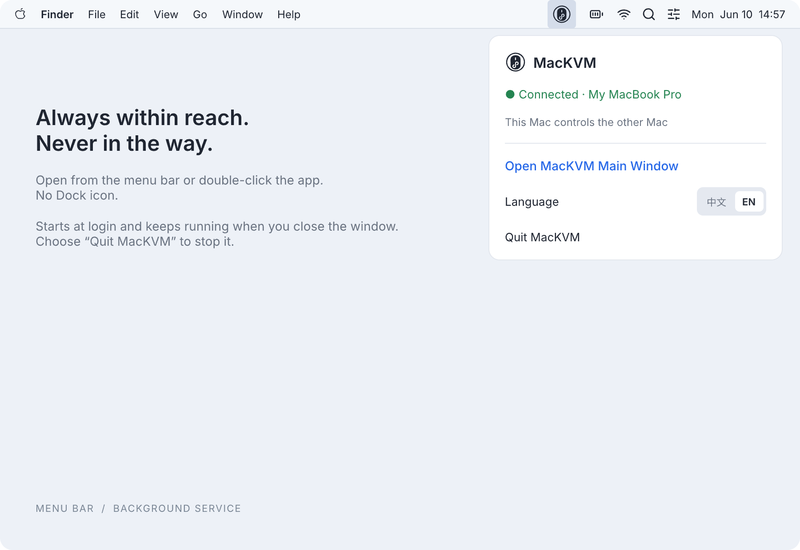
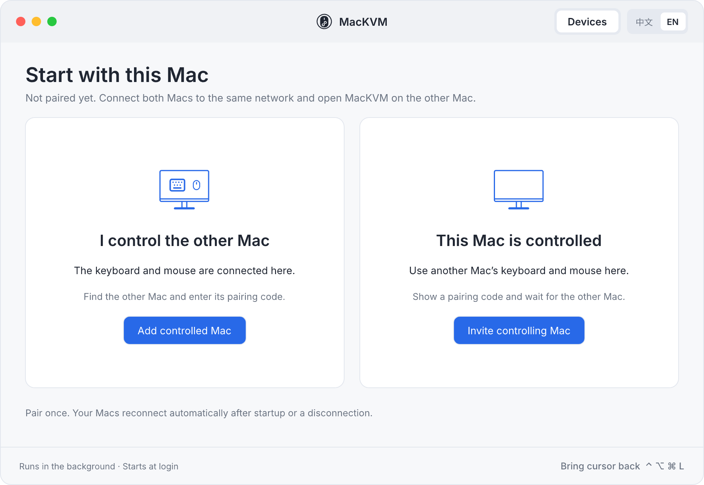
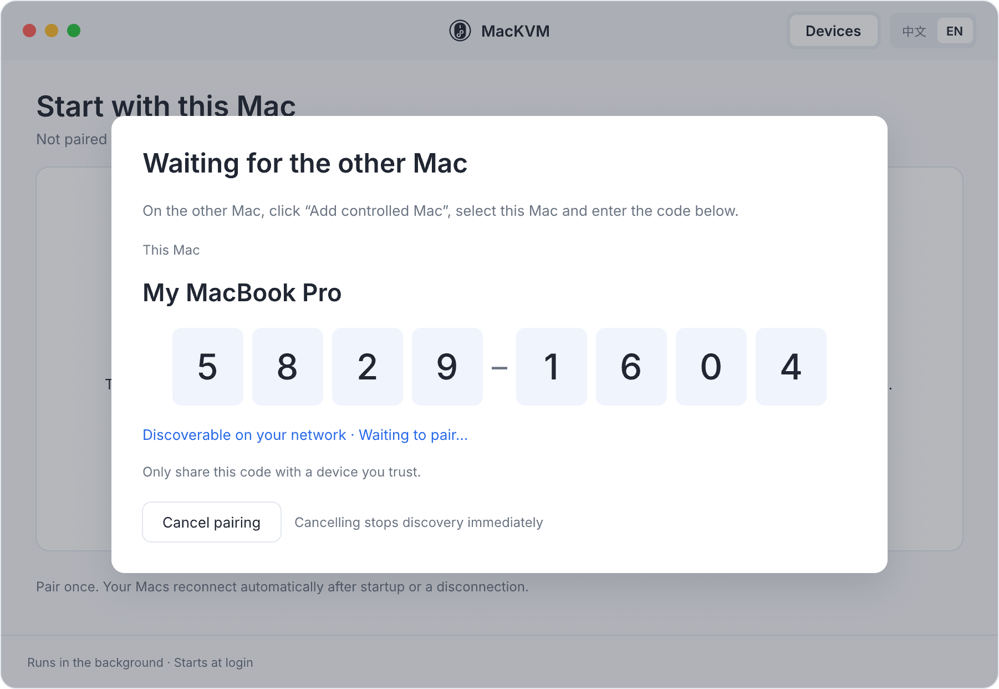
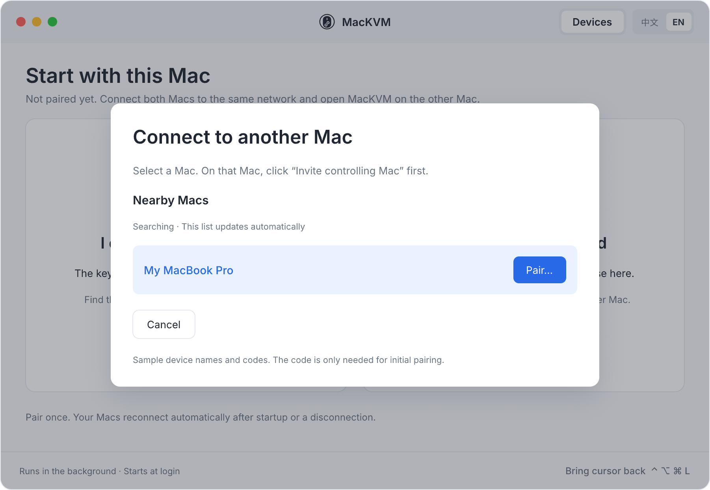
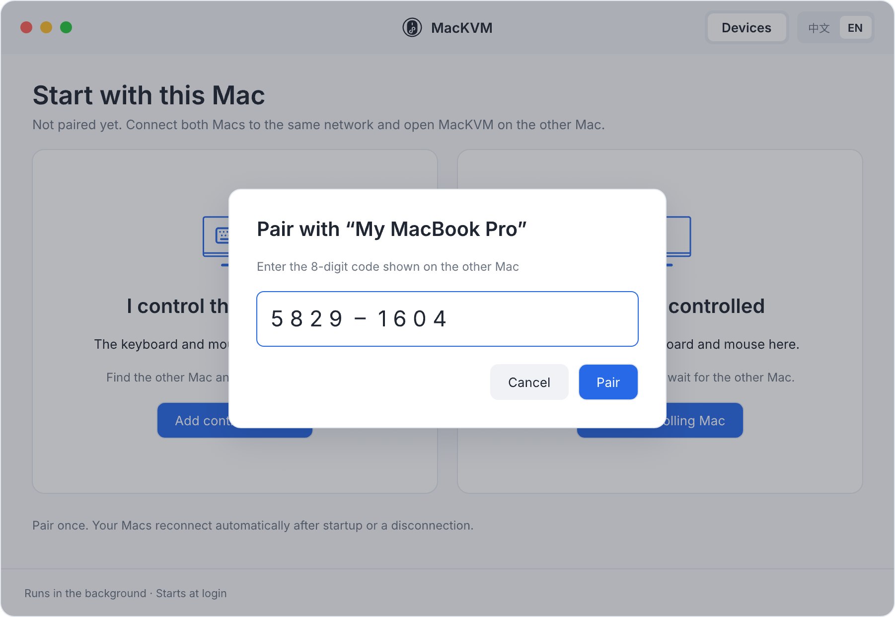
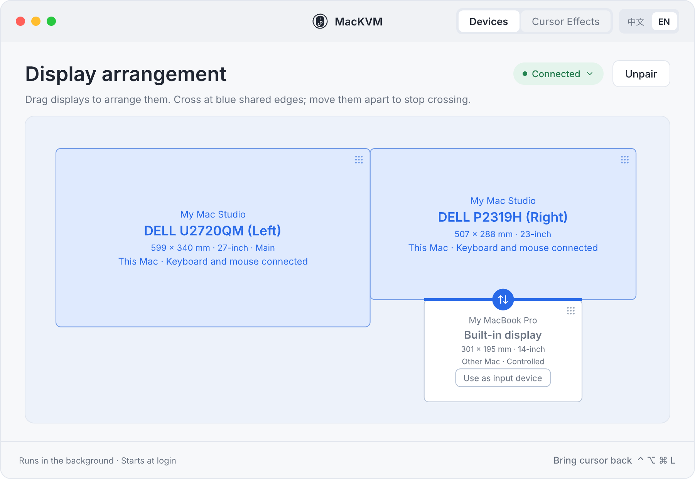
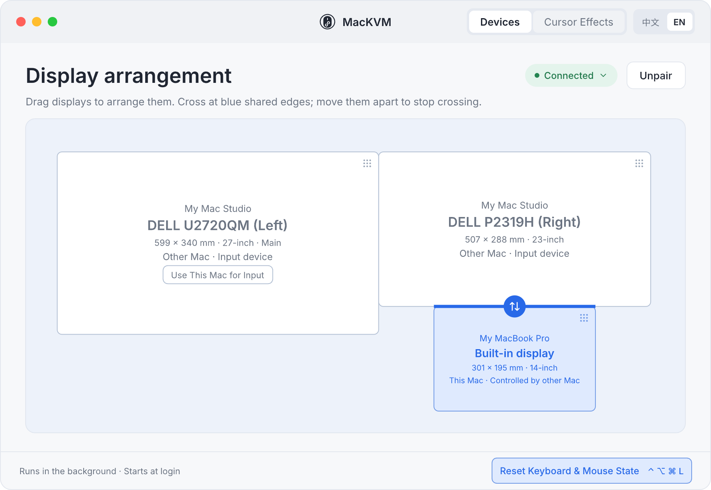
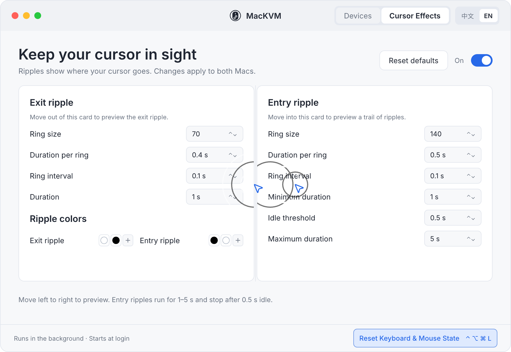
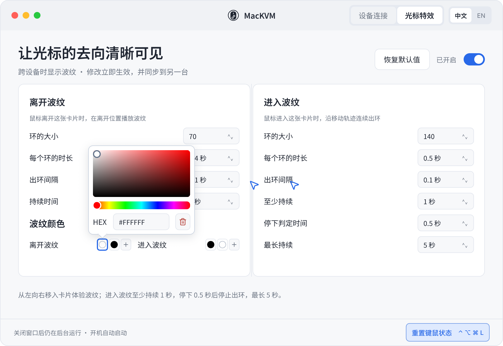

# MacKVM

One keyboard and mouse, shared across multiple computers. Plug them into one controlling Mac, push the cursor across
any shared screen edge, and input follows to the target machine. One Mac controller supports multiple controlled devices
(**macOS** and **Ubuntu X11**), and controlled devices can also cross directly into each other according to the layout.
Built directly on native OS APIs (zero third-party dependencies on macOS; system Python 3 + GTK3/Cairo + X11 + Avahi on Ubuntu).

**中文：** see [README.md](README.md). Comments and logs in the source are in Chinese.

## What it does

- **1-to-N Star Topology (macOS + Ubuntu X11)**: One Apple silicon Mac acts as the controller (holding the keyboard and mouse) and pairs with one or more controlled devices (macOS or Ubuntu X11). Two-Mac setups still allow swapping roles from the UI; with 3+ devices or any Ubuntu peer, the controller stays fixed on the Mac with input hardware attached.
- **Physical Layout & Direct Peer-to-Peer Crossing**: On the Devices page, arrange every device's displays on a shared plane scaled by physical size (millimetres), independent of resolution or scaling. Wherever two different devices' edges touch (turning blue)—including directly between two controlled devices (relayed through the controller)—the cursor crosses in both directions. Each machine can have any number of displays.
- **Display Hotplug Memory & Manual Cleanup**: Newly plugged displays appear automatically and work immediately. Unplugged displays remain at their last coordinates as dashed "Unplugged" placeholders so you don't lose their placement if temporarily disconnected. If a display is permanently gone, click the `×` button at the top-right of its unplugged card to remove it from the layout and rules without unpairing.
- **Cursor Ripples**: Crossing plays an expandable ripple where the cursor leaves and a trail of rings where it arrives. Styles sync automatically to all connected peers, including the Ubuntu X11 desktop overlay.
- **Pair Once, Reconnect Automatically**: Initial pairing uses an 8-digit code over the LAN; subsequent startups and reconnects discover peers automatically and encrypt traffic with keys derived during pairing.
- **Reset Keyboard & Mouse State**: Press `Ctrl + Option + Cmd + L` on macOS (`Ctrl + Alt + Super + L` on Ubuntu), or click "Reset Keyboard & Mouse State" on a controlled Mac window/menu, to return focus and cursor to the controller immediately.
- **Linux Key Mapping**: When controlling Ubuntu, `Command ↔ Control` is swapped by default and can be toggled from the Ubuntu tray menu or status window.
- **Bilingual UI**: Switch between Chinese and English at any time via the `中文 / EN` toggle in the title bar or menu bar menu on macOS (follows system language by default).

Not planned: Windows, Linux Wayland (Ubuntu client requires X11 and acts as controlled-only), clipboard sync, file drag-and-drop.

## Requirements

### macOS (Controller or Controlled)

- Apple silicon Mac running macOS 26 or later.
- On the same local network, able to discover Bonjour services (`_mackvm-pair._tcp` / `_mackvm._tcp`).
- Accessibility permission enabled for MacKVM on each Mac (`System Settings → Privacy & Security → Accessibility`) and Local Network access allowed.
- Xcode command line tools (`swiftc`) to build.

### Ubuntu (Controlled, X11 only)

- Ubuntu Desktop running an **X11** session (Wayland is not supported), on the same LAN as the controller.
- System packages: `python3`, `python3-cryptography`, `python3-gi` (GTK3 / Cairo), `gir1.2-appindicator3-0.1` (optional tray menu), `avahi-utils` (`avahi-publish-service` / `avahi-browse`), `x11-xserver-utils` (`xrandr`), and X11 shared libraries (`libX11`, `libXtst`, `libXfixes`).

## Install

### macOS (Controller and Controlled Macs)

On each Mac:

```bash
git clone https://github.com/leo4stone/mackvm.git
cd mackvm
./build.sh          # build, sign, install to ~/Applications/MacKVM.app
./install-agent.sh  # install as a login LaunchAgent and start it
```

Then:

1. System Settings → Privacy & Security → Accessibility: turn on MacKVM. The first launch prompts for it; the app continues on its own once granted.
2. When macOS asks to allow finding local network devices, allow it.
3. Pair devices as described below.

If MacKVM cannot be added to the Accessibility list with `+` (usually after bundle ID changes or moving `MacKVM.app`), reset the stale Launch Services entry and restart without rebooting:

```bash
/System/Library/Frameworks/CoreServices.framework/Frameworks/LaunchServices.framework/Support/lsregister -f ~/Applications/MacKVM.app
launchctl kickstart -k gui/$(id -u)/io.github.leo4stone.mackvm
```

Logs are in `~/Library/Logs/MacKVM.log`. Pairing state and keys are in `~/Library/Application Support/MacKVM/state.json`.
To uninstall: `launchctl bootout gui/$(id -u)/io.github.leo4stone.mackvm`, then delete `~/Applications/MacKVM.app` and the two paths above.

### Ubuntu X11 (Controlled Client)

From your controlling Mac over SSH (set `MACKVM_LINUX_HOST` in `local.env` to omit the argument):

```bash
./deploy-linux.sh <ubuntu-ssh-host>
```

This uploads `linux/`, runs `test_linux.py` remotely, installs into `~/.local/share/mackvm`, and starts the login `systemd --user` service `mackvm.service`. Or install directly on Ubuntu:

```bash
cd linux
./install-linux.sh
```

- Displays an indicator icon in the Ubuntu top bar; you can also open the status/pairing window with `~/.local/bin/mackvm-linux --show`.
- While unpaired, the active 8-digit pairing code is also written to `~/.config/mackvm/pair.code`.
- State and keys live in `~/.config/mackvm/state.json`; logs in `~/.local/state/mackvm/mackvm.log`.
- To uninstall: `systemctl --user disable --now mackvm.service` and remove `~/.local/share/mackvm`, `~/.local/bin/mackvm-linux`, `~/.config/systemd/user/mackvm.service`, `~/.local/share/applications/mackvm.desktop`, plus the config and log directories above.

## How to use

The screenshots below show the core 2-Mac design; the app UI matches them with multi-device extensions noted below. Device names are examples.

### The menu bar

Once installed on macOS, MacKVM lives only in the menu bar with no Dock icon. Click the icon to open the main window;
right-click (or Control-click) for status, opening the main window, resetting keyboard & mouse state (shown when controlled), switching language, or quitting.
Closing the window keeps MacKVM running in the background; it starts automatically at login. Choose "Quit MacKVM" to stop it.



### Step 1: choose this Mac's role

Open the main window. The Mac with the keyboard and mouse is the controller: click "Add controlled Mac".
Another Mac is controlled: click "Invite controlling Mac". (Ubuntu automatically starts waiting for pairing after installation.)
Put the controlled machine into invite mode first.



### Step 2: pair

A controlled Mac waiting to pair shows an 8-digit code and advertises itself on the LAN (on Ubuntu, view the code in its window/tray or `~/.config/mackvm/pair.code`).



On the controller, click "Add controlled Mac" (or "+ Add device" in the Devices header when already paired to add a 2nd/3rd device). Select the device in the list and click "Pair".



Enter the 8-digit code shown on the controlled screen. After 5 wrong attempts a fresh code is generated.



You pair once per controlled device. Future startups and disconnections reconnect automatically using derived encryption keys.

### Step 3: arrange the displays

After pairing you land on the Devices page showing all displays scaled by physical size.
This device's displays are blue, and each paired remote device gets a distinct card tint. Every online display can be dragged and snaps cleanly without overlapping.

Wherever two different devices touch along an edge—including directly between two controlled devices—that segment turns blue. Push the cursor across a blue seam to jump to that device and back again. Changes sync immediately to all online peers.



- **Default & appended placement**: Pairing the first peer generates a centered side-by-side default layout; pairing additional peers appends them cleanly to the right edge. Arrangement affects only cursor crossing, not macOS/X11 native display coordinates.
- **Hotplug memory & removing unplugged cards**: Newly attached displays appear automatically. Disconnected displays stay at their last coordinates as dashed "Unplugged" cards so unplugging temporarily never ruins your layout. If you no longer use an unplugged display on that machine, click the `×` button in its top-right corner to remove it permanently without unpairing.
- **Multi-device controls & role swap**: Click the status pill to inspect per-device status or unpair an individual peer. "Use as input device" only appears in 2-Mac setups.

### Crossing and resetting keyboard & mouse state

- Push through a blue edge segment to switch devices; keyboard input follows. Do not expect crossing while holding a mouse button (dragging windows)—this is intentional.
- Press **Ctrl + Option + Cmd + L** on macOS (**Ctrl + Alt + Super + L** on Ubuntu) at any time, or click "Reset Keyboard & Mouse State" on a controlled Mac window, to return control immediately to the controller's main display center.
- You can still adjust the layout while a peer is offline; the higher revision syncs automatically upon reconnect.

The Devices page as seen on a controlled Mac: its own display is blue, and the reset button sits at the bottom right.



### Cursor effects

The Cursor Effects page tunes the departure ring and arrival trail. Size, duration, interval, and colours apply immediately and sync across all connected devices (rendered natively on Ubuntu via transparent shaped X11 Cairo windows). Move between the two preview cards to test, or switch the master toggle off to hide ripples.



Click any colour swatch to adjust hue/HEX live; right-click or use the popover delete button to remove a swatch (at least one remains per group), or click `+` to add one.



### Switching language

Use the `中文 / EN` toggle in the macOS title bar or menu bar menu to switch UI language immediately without restarting (saved locally per Mac).

## About code signing and deploy scripts (read this first)

`build.sh` signs ad-hoc by default, requiring no Apple certificate, at the cost of re-enabling MacKVM in System Settings → Privacy & Security → Accessibility after every rebuild.

If you have a Developer ID certificate, copy `local.env.example` to `local.env` and set `MACKVM_SIGN_IDENTITY`. `build.sh` binds permissions to that certificate so rebuilds retain Accessibility access (`local.env` stays untracked).

- `deploy-remote.sh <ssh host>`: copies the locally built `MacKVM.app` to another Mac and reloads its LaunchAgent (configurable via `MACKVM_DEPLOY_HOST` in `local.env`).
- `deploy-linux.sh <ssh host>`: syncs `linux/` to an Ubuntu X11 host, runs Python unit tests remotely, and restarts `mackvm.service` (configurable via `MACKVM_LINUX_HOST` in `local.env`).

## Known limitations and trade-offs

- **Two private macOS APIs are used** (`_CGSDefaultConnection` and `CGSSetConnectionProperty` for `SetsCursorInBackground`) via `dlsym` to hide the cursor while MacKVM runs in the background. If removed in a future macOS release, the cursor remains visible without crashing. MacKVM cannot be distributed on the Mac App Store.
- **macOS Dock cursor control**: resting at screen edges or entering the Dock overrides background cursor hiding; see `design/屏幕相邻规则-需求定稿.md` section 7 (Chinese) for the mitigation.
- **Ubuntu scope**: controlled-only and X11-only (no Wayland). All events route through the macOS controller, so controller role-swapping is disabled whenever 3+ devices or any Linux peer are paired.
- **Home-grown pairing protocol**: CPace-style X25519 mixing the 8-digit pairing code into the generator, HMAC verification, HKDF long-term key derivation, and ChaCha20-Poly1305 encrypted transport. It has not undergone third-party security auditing.
- **Tested on**: Mac Studio (controller, macOS 26, external display) + MacBook Pro (controlled, macOS 26, built-in + external display) + Ubuntu X11 desktop (controlled). Other setups should work but have not been verified.
- Holding a mouse button inhibits crossing intentionally so window drags stay smooth.

## Source layout

```
Sources/
  main.swift            startup, single instance, LaunchAgent detection
  AppModel.swift        coordinator: multi-peer pairing, star links, roles, layout, settings sync
  ControllerRole.swift  controller: input capture, multi-peer crossing, cursor hiding, Mac/Linux encoding
  ControlledRole.swift  controlled: event injection, exit & handoff detection
  CursorHider.swift     cursor show/hide on controlled macOS
  Adjacency.swift       adjacency geometry and crossing math (pure logic, unit tested)
  Layout.swift          display layout: arranging, snapping, multi-peer append, unplugged removal, rule derivation
  Screens.swift         local display enumeration and usable frame
  Pairing.swift         pairing handshake
  Link.swift / Peer.swift / Discovery.swift   multi-peer LinkHub, encrypted framing, Bonjour
  Ripple.swift / RipplePreview.swift          ripple effects
  Settings.swift        persisted state and multi-device summaries
  UI/                   SwiftUI interface (UI/Strings.swift holds bilingual strings)
linux/
  mackvm_linux/         Ubuntu X11 daemon (XTest/XFixes input, XRandR screens, Avahi mDNS, GTK3 tray/UI, Cairo ripples)
  test_linux.py         Ubuntu client unit tests
  install-linux.sh      systemd --user installer for Ubuntu
Resources/              app icon assets bundled into MacKVM.app/Contents/Resources
Verify/
  verify.sh             macOS self-tests + offscreen UI rendering (not shipped)
design/                 design exports and requirement documents (Chinese)
docs/images/            screenshots referenced by READMEs
build.sh / install-agent.sh / deploy-remote.sh / deploy-linux.sh  build and deploy scripts
```

Self-tests: `./Verify/verify.sh` on macOS (unit, loopback, two-process handshake, offscreen render) and `python3 linux/test_linux.py` for Ubuntu logic.

## License

MIT, see `LICENSE`.
