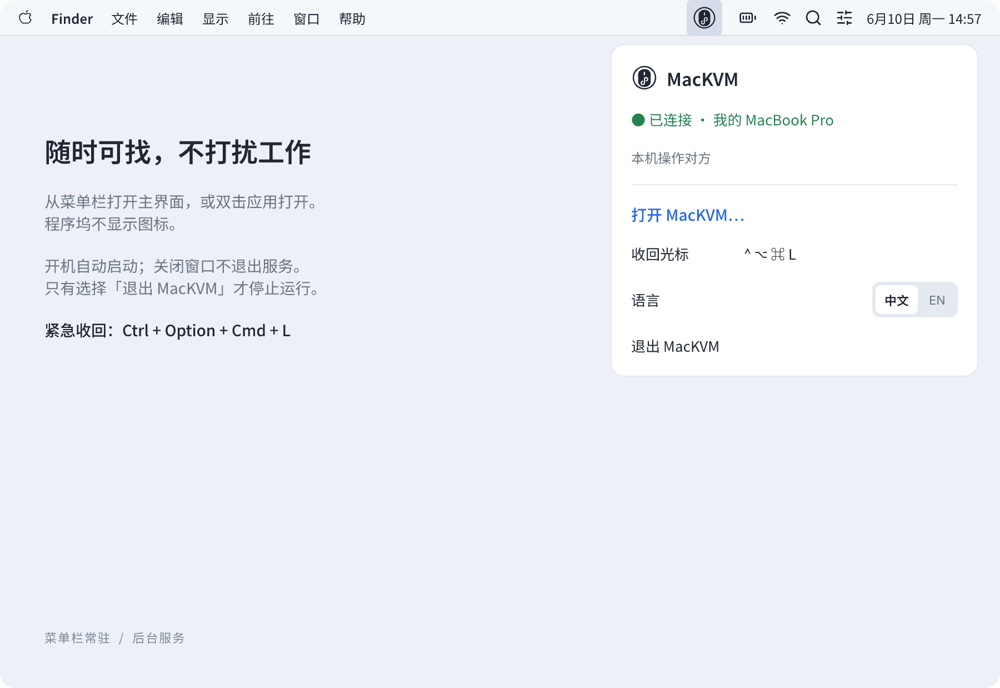
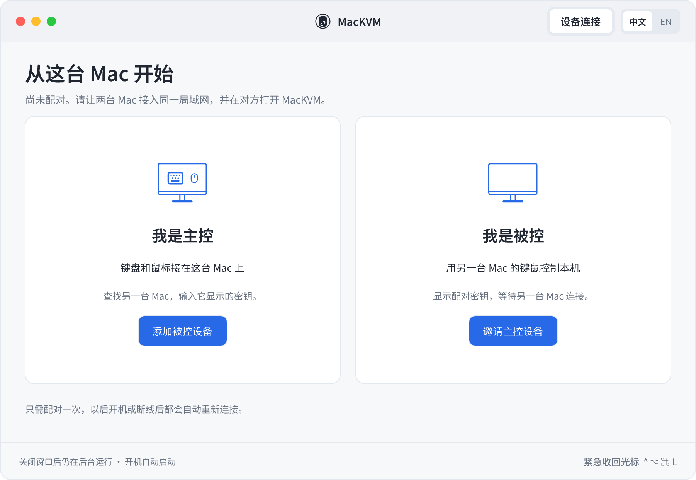
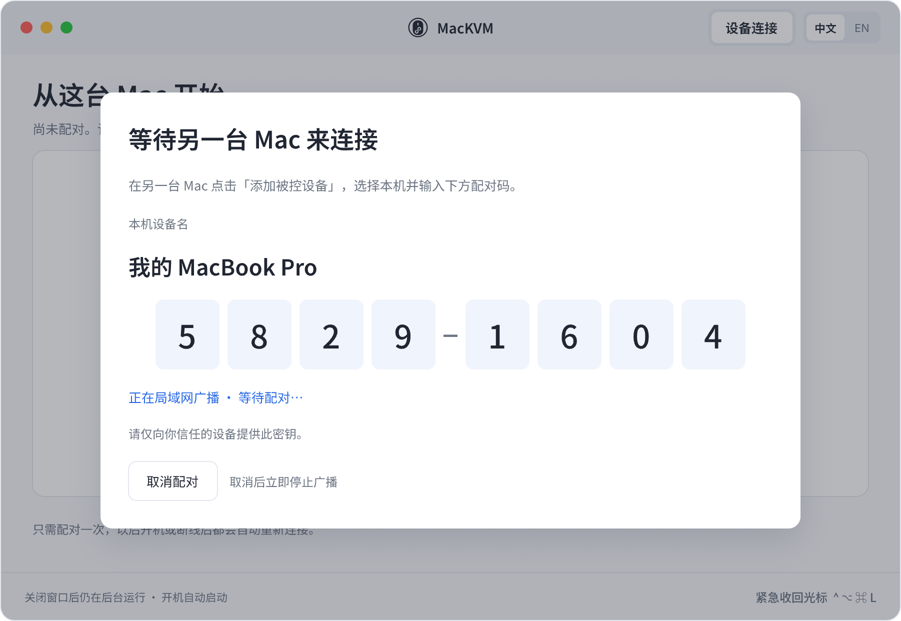
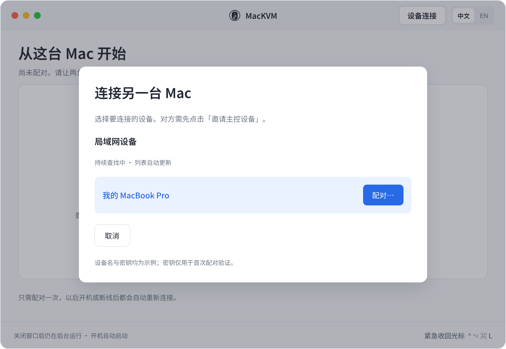
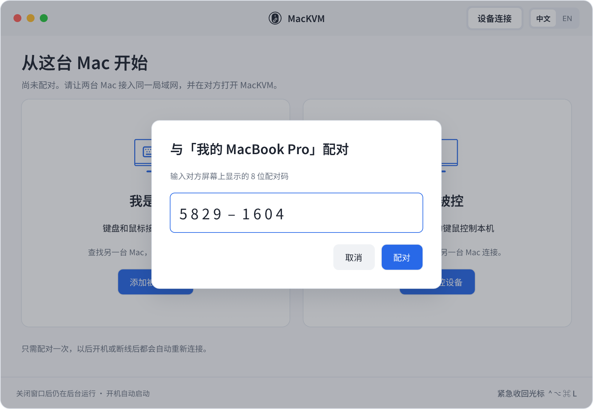
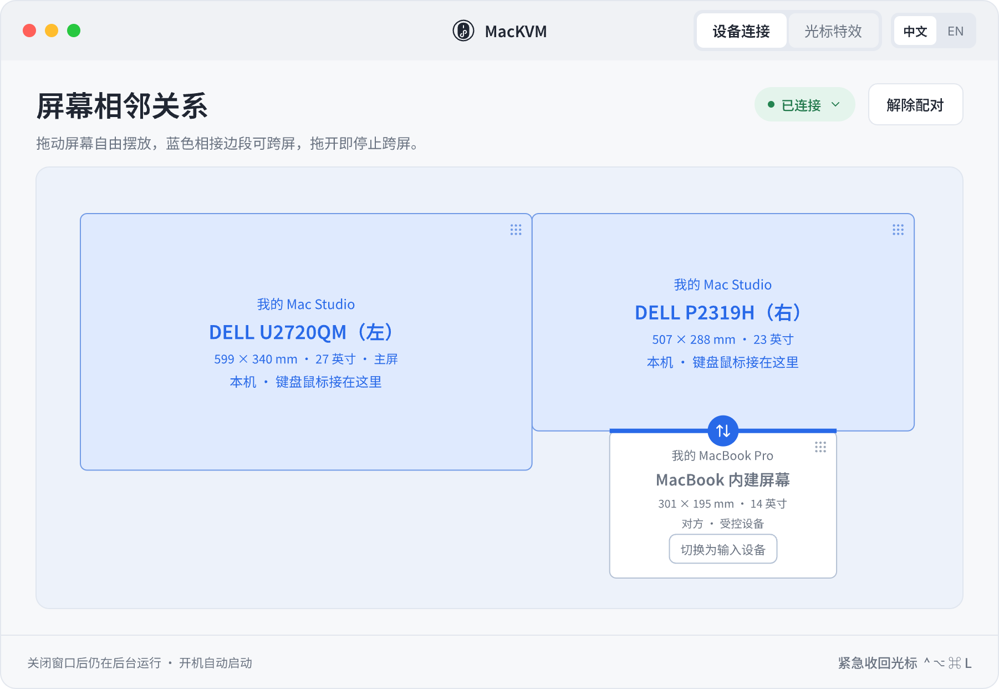
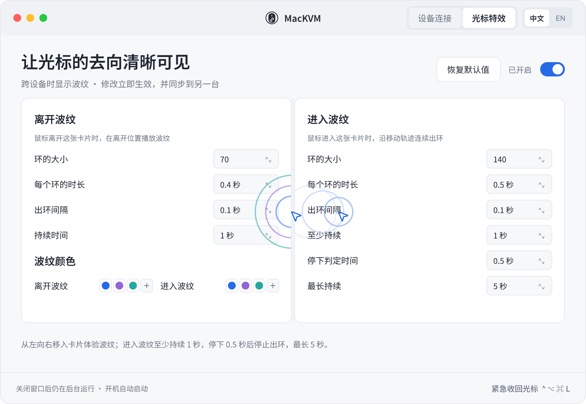

# MacKVM

一套键盘鼠标，两台 Mac 共用。键鼠接在其中一台上，光标推过屏幕边就切到另一台，键盘跟着走。
只做这一件事，只支持两台 Mac，没有第三方依赖，源码一个下午能读完。

**English:** see [README.en.md](README.en.md).

## 它做什么

- 一台当主控（键鼠接在它上面），另一台被控。角色可以在界面上对调。
- 在「设备连接」页把两台的显示器摆在一起：本机的屏和对方的屏挨着的那一段边，光标就能双向跨过去，拖开就跨不过去。
  按物理尺寸（毫米）对应，和分辨率、缩放无关。每台可以接任意多块显示器。
- 光标跨过去时，离开的一侧和到达的一侧各出一圈波纹提示，样式可调，两台同步。
- 局域网内用 8 位配对码配对，之后自动发现、自动重连。
- 紧急收回热键 Ctrl+Option+Cmd+L：任何时候把光标拉回主控。
- 界面支持中文和英文：在主窗口标题栏或菜单栏菜单里的「中文 / EN」随时切换，立即生效，默认跟随系统语言。

不做的事：Windows / Linux、三台以上、剪贴板同步、文件拖拽。这些不在计划里。

## 要求

- 两台 Apple silicon 的 Mac，macOS 26 或更新。
- 两台在同一个局域网里，能互相发现 Bonjour 服务。
- 每台都要在「系统设置 → 隐私与安全性 → 辅助功能」里打开 MacKVM。首次启动会提示。
- 编译需要 Xcode 命令行工具（`swiftc`）。

## 安装

在每一台 Mac 上：

```bash
git clone https://github.com/leo4stone/mackvm.git
cd mackvm
./build.sh          # 编译、签名、装到 ~/Applications/MacKVM.app
./install-agent.sh  # 装成登录自启的 LaunchAgent 并启动
```

然后：

1. 系统设置 → 隐私与安全性 → 辅助功能，打开 MacKVM。第一次启动时会有提示；授权后程序自己继续。
2. 第一次访问局域网时系统会弹「允许查找本地网络设备」，选允许。
3. 按下面的使用说明配对。

如果在辅助功能列表里用「+」加 MacKVM 加不进去（通常发生在换过程序标识、或 MacKVM.app 换过位置之后），
是启动服务数据库里的旧记录在作怪，重新登记一次再启动即可，不用重启电脑：

```bash
/System/Library/Frameworks/CoreServices.framework/Frameworks/LaunchServices.framework/Support/lsregister -f ~/Applications/MacKVM.app
launchctl kickstart -k gui/$(id -u)/io.github.leo4stone.mackvm
```

日志在 `~/Library/Logs/MacKVM.log`，配对状态和长期密钥在 `~/Library/Application Support/MacKVM/state.json`。
卸载：`launchctl bootout gui/$(id -u)/io.github.leo4stone.mackvm`，删掉 `~/Applications/MacKVM.app` 和上面两个路径。

## 使用说明

下面的界面图来自设计稿，和程序里的样子一致；设备名是示例。

### 菜单栏入口

MacKVM 装好后只在菜单栏有一个图标，没有程序坞图标。点图标可以看连接状态、打开主窗口、紧急收回光标、切换语言、退出。
关掉主窗口程序仍在后台运行，开机自动启动；要停掉就选「退出 MacKVM」。



### 第一步：选择本机角色

两台都打开主窗口。键盘鼠标接在哪台，哪台就是主控，点「添加被控设备」；另一台是被控，点「邀请主控设备」。
先点被控那台。



### 第二步：配对

被控那台点「邀请主控设备」后显示一个 8 位配对码，并在局域网里广播自己。



主控那台点「添加被控设备」，列表里会出现正在邀请的那台，点「配对」。



输入被控那台屏幕上的 8 位配对码。输错 5 次对方会换一个新码。



配对只做一次。之后两台开机、断线后都自动重连，不需要再输码。配对码只用于首次验证，之后的连接用配对时派生的密钥加密。

### 第三步：摆放屏幕

配对完成后进入「设备连接」页。预览区里画着两台 Mac 的全部显示器，按物理尺寸等比例。
本机的屏是蓝色，对方的屏是白色。每块屏都能拖，靠近别的屏时会吸附，两块屏不能叠放。

本机的屏和对方的屏挨上的那一段边会变成蓝色，光标从这段边推出去就切到另一台，从对面推回来就切回来。
拖开就跨不过去了。摆放结果两台同步，立即生效。



配对完成时程序会自动摆好一个默认布局：对方的屏放在本机最右侧屏的右边、中点对齐。这里的摆法只决定光标怎么跨，和
macOS 自己的显示器排列无关。

对方屏上的「切换为输入设备」把两台的角色对调：确认后键鼠要接到对方那台。标题区的「解除配对」让两台都回到未配对状态。

### 跨屏和收回光标

- 光标推过蓝色边段就切到另一台，键盘输入跟着过去。推回来就切回来。
- 按住鼠标键拖东西时不会跨屏，这是有意的。
- 任何时候按 **Ctrl + Option + Cmd + L** 把光标拉回主控，比如对方死机、断网的时候。
- 对方不在线时预览区照常可以拖，重连后同步。

### 光标特效

「光标特效」页调跨屏时的波纹提示：离开一侧出一圈，到达一侧沿移动轨迹连续出环。大小、时长、间隔、颜色都能改，修改立即生效并同步到另一台。
在两张卡片之间左右移动鼠标可以预览。总开关关掉就不显示波纹，不影响键鼠共享。



### 切换语言

标题栏右侧和菜单栏菜单里都有「中文 / EN」开关，点一下立即切换，不用重启。默认跟随系统语言；手动切过之后记住选择，只对本机生效。

## 关于签名（请先读）

`build.sh` 默认用 ad-hoc 签名，不需要任何证书。代价是：**每次重新编译后，辅助功能授权都会失效，要到系统设置里关掉再打开一次。**
这是 macOS 的规则，授权绑定的是程序的内容哈希。

如果你有 Apple 开发者账号的 Developer ID 证书，复制 `local.env.example` 为 `local.env`，填上证书名字，
`build.sh` 就会用它签名，授权绑定到证书，重新编译不用重新授权。`local.env` 不会入库。
证书是使用者自己的选择，项目本身不要求。

`deploy-remote.sh <ssh 主机名>` 可以把本机编译好的程序复制到另一台并装好 LaunchAgent，省得两边各编一次；
它只复制产物，签名以本机为准。

## 已知限制和实现上的取舍

- **用了两个私有接口。** 主控方要在后台把本机光标藏起来，这件事公开接口做不到，用的是 `_CGSDefaultConnection`
  和 `CGSSetConnectionProperty`（设 SetsCursorInBackground）。通过 dlsym 运行时查找，符号没了只是藏不住光标、不会崩。
  这决定了它进不了 Mac App Store，系统大版本升级后可能失效。
- **程序坞会抢光标控制权。** 光标压在屏幕边上或进过程序坞之后，macOS 会无视后台进程的隐藏请求。
  项目里的应对（跨出后补发一个事件再重申隐藏）以及背后的依据，见 `design/屏幕相邻规则-需求定稿.md` 第七节。
- **配对协议是自己设计的**：CPace 式 X25519，8 位配对码混进基点，HMAC 确认，HKDF 派生长期密钥，之后的连接用它加密。
  没有经过第三方审计。局域网里的键鼠事件流经它，自己判断是否够用。
- **实测范围**：作者的 Mac Studio（两块显示器）加 MacBook Pro（内建屏），macOS 26，Logi Bolt 接收器接在 Mac Studio。
  其他组合按理可用，但没有验证。
- 拖动窗口中途不会跨屏（按住鼠标键时规则不触发），这是有意的。

## 源码结构

```
Sources/
  main.swift            启动、单实例、LaunchAgent 判断
  AppModel.swift        总调度：配对、连接、角色、布局与规则、设置同步
  ControllerRole.swift  主控：截获键鼠、跨屏判定、隐藏光标、转发
  ControlledRole.swift  被控：注入事件、离开判定
  CursorHider.swift     被控方光标显隐
  Adjacency.swift       相邻规则的几何、跨屏判定（纯逻辑，有自测）
  Layout.swift          屏幕布局：摆放、吸附、从布局推导相邻规则、默认布局、旧数据迁移（纯逻辑，有自测）
  Screens.swift         本机显示器清单、可用区域
  Pairing.swift         配对协议
  Link.swift / Peer.swift / Discovery.swift   连接、加密帧、Bonjour
  Ripple.swift / RipplePreview.swift          波纹效果
  Settings.swift        状态文件
  UI/                   SwiftUI 界面（UI/Strings.swift 是中英文文案表）
Resources/              打进 MacKVM.app/Contents/Resources 的资源（程序图标）
Verify/
  verify.sh             自测 + 离屏渲染（不进产物）
design/                 界面设计稿导出图和需求文档
docs/images/            README 用的界面图（从设计稿导出）
```

自测：`Verify/verify.sh`（单元、配对回环、双进程握手、离屏渲染）。

## 许可证

MIT，见 `LICENSE`。
