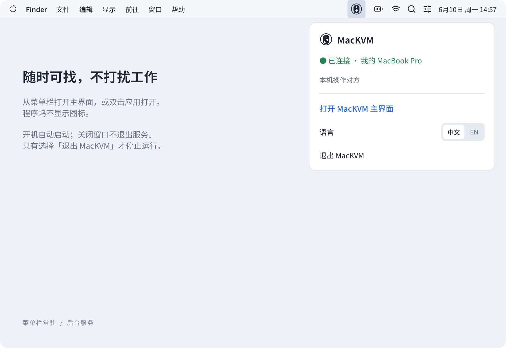
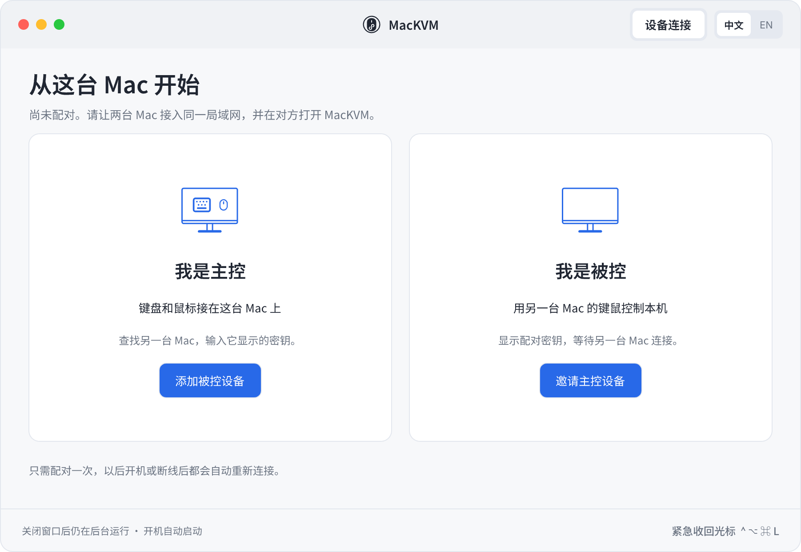
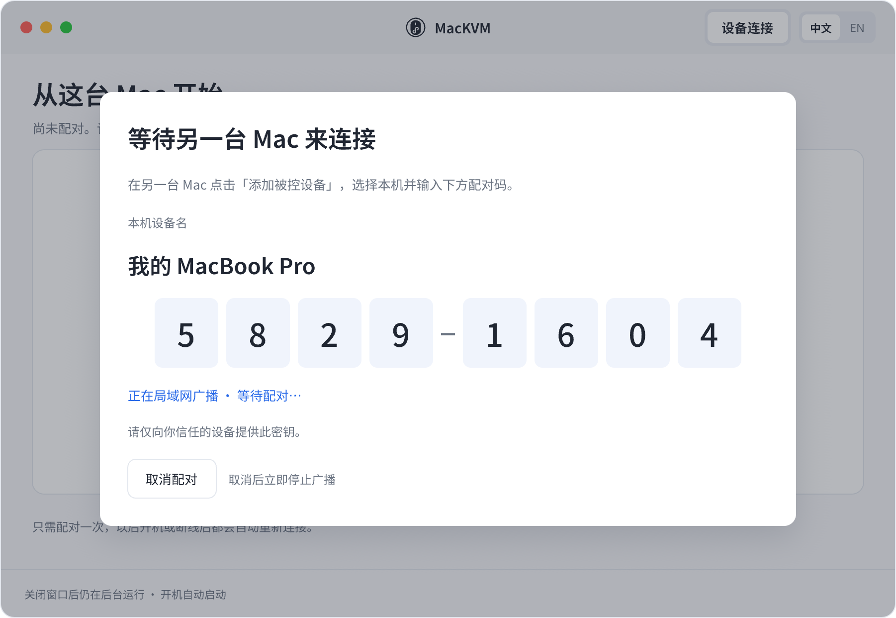
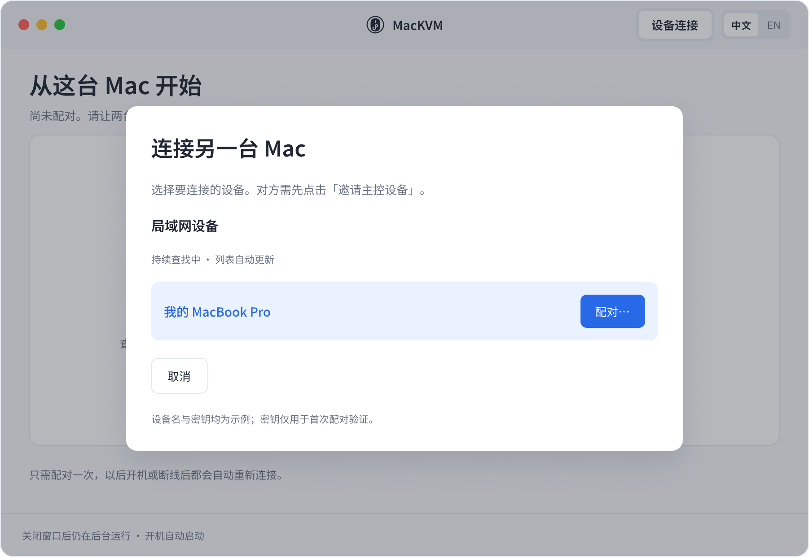
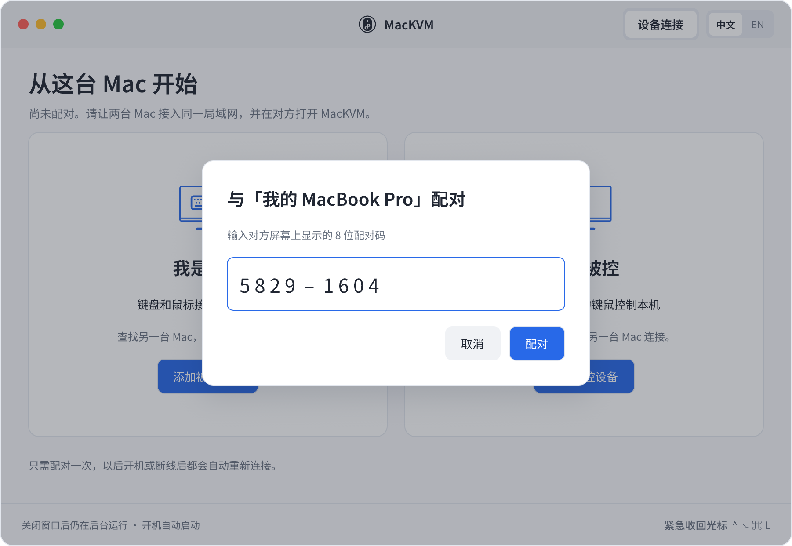
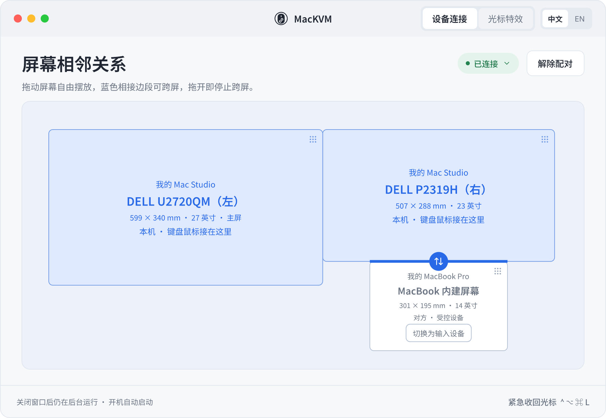
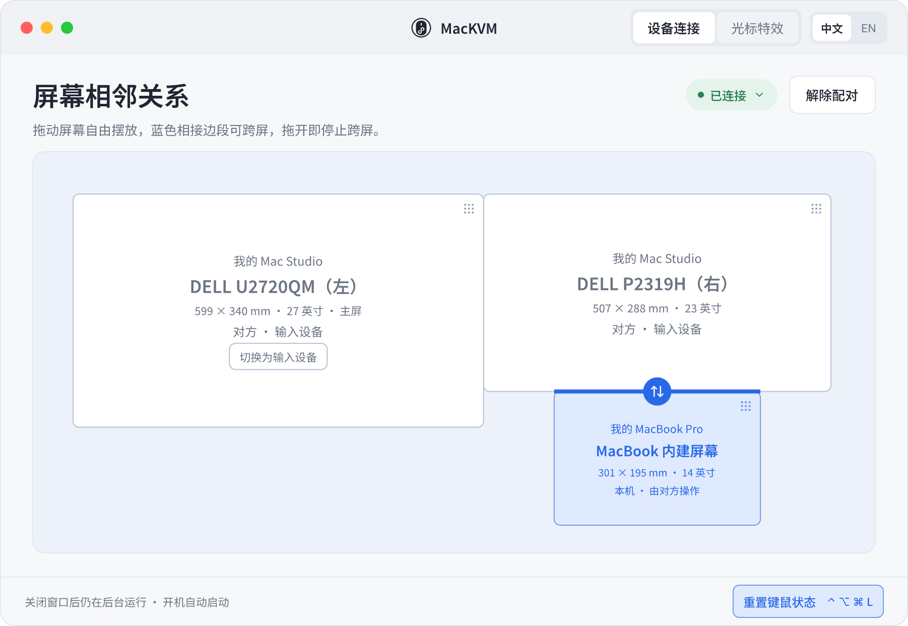
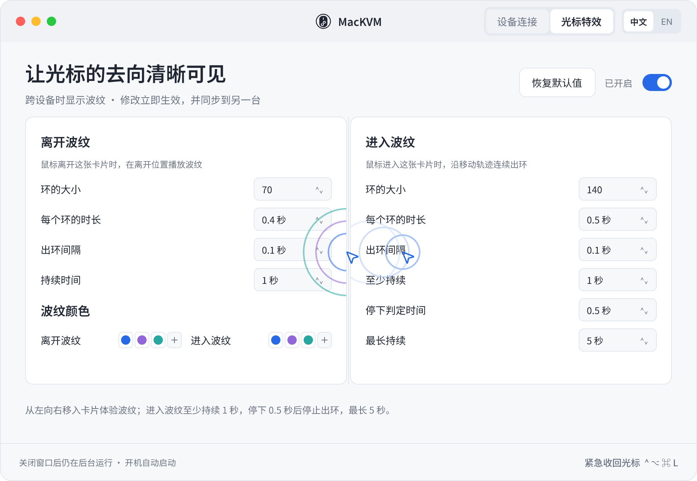
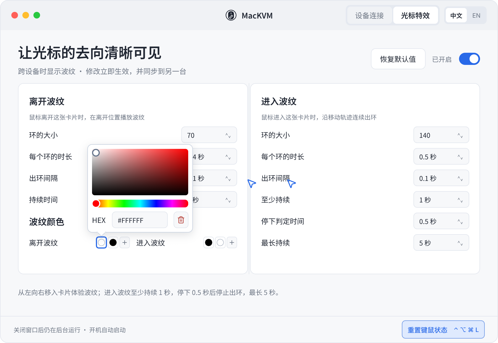

# MacKVM

一套键盘鼠标，多台电脑共用。键鼠接在主控 Mac 上，光标推过屏幕边就切过去，键盘跟着走；支持 1 台主控 Mac 带多台被控设备（macOS 与 Ubuntu X11），被控设备之间也能按布局直接互切。
源码精简、直接基于系统能力实现（macOS 端零第三方依赖，Ubuntu 端仅使用系统自带的 Python / GTK3 / X11 / Avahi 组件）。

**English:** see [README.en.md](README.en.md).

## 它做什么

- **一主多控与跨平台（星型拓扑）**：一台 Apple silicon Mac 当主控（键鼠接在它上面），可配对 1 台或多台被控设备（macOS 或 Ubuntu X11）。仅两台 Mac 配对时支持在界面上随时对调主控/被控；超过两台设备或包含 Ubuntu 时，主控固定在连接键鼠的 Mac 上。
- **按物理尺寸摆放与直连互切**：在「设备连接」页把所有设备的显示器按物理尺寸（毫米）摆在同一张平面上，与分辨率、缩放无关。任意两台不同设备的屏幕沿边挨出蓝色边段即可双向跨屏——包括两台被控设备（如 MacBook Pro 与 Ubuntu）之间直接跨屏（由主控中转）。每台设备可接任意多块显示器。
- **插拔记忆与按需清理**：在线插上的新显示器自动识别并加入布局；暂时拔掉的显示器会留在原位显示为「未接上」以记住摆放配置，下次插回自动恢复。确认不再使用某块「未接上」显示器时，点卡片右上角的 `×` 即可将其从布局和规则中移除，无需解除配对重连。
- **跨屏波纹提示**：光标跨过边段时，离开的一侧和到达的一侧各出波纹提示，样式可调，修改后自动同步到所有已连接被控端（含 Ubuntu X11 桌面）。
- **一次配对，自动重连**：局域网内用 8 位配对码完成一次配对，之后开机或断线自动发现并加密重连。
- **重置键鼠状态**：Mac 端任意时候按 `Ctrl + Option + Cmd + L`（Ubuntu 端按 `Ctrl + Alt + Super + L`），或点击被控端主界面底栏的「重置键鼠状态」，即可立刻收回光标和键盘。
- **键盘映射**：控制 Ubuntu 时默认自动对调 `Command ↔ Control`，可在 Ubuntu 托盘菜单或状态窗口中一键切换。
- **中英文界面**：Mac 端主窗口标题栏或菜单栏菜单中的「中文 / EN」随时切换，立即生效，默认跟随系统语言。

不做的事：Windows、Linux Wayland（Linux 仅支持 X11 且暂仅作被控端）、剪贴板同步、文件拖拽。这些不在计划里。

## 要求

### macOS（主控 / 被控）

- Apple silicon 的 Mac，macOS 26 或更新。
- 处于同一局域网内，能互相发现 Bonjour 服务（`_mackvm-pair._tcp` / `_mackvm._tcp`）。
- 每台 Mac 都要在「系统设置 → 隐私与安全性 → 辅助功能」里打开 MacKVM（首次启动会提示），并允许本地网络访问。
- 编译需要 Xcode 命令行工具（`swiftc`）。

### Ubuntu（被控端，仅 X11）

- Ubuntu Desktop **X11** 会话（暂不支持 Wayland），与主控在同一个局域网内。
- 已安装系统组件：`python3`、`python3-cryptography`、`python3-gi`（GTK3 / Cairo）、`gir1.2-appindicator3-0.1`（顶部托盘图标，可选）、`avahi-utils`（`avahi-publish-service` / `avahi-browse`）、`x11-xserver-utils`（`xrandr`）以及 X11 运行库（`libX11`、`libXtst`、`libXfixes`）。

## 安装

### macOS（主控及被控 Mac）

在每一台 Mac 上：

```bash
git clone https://github.com/leo4stone/mackvm.git
cd mackvm
./build.sh          # 编译、签名、装到 ~/Applications/MacKVM.app
./install-agent.sh  # 装成登录自启的 LaunchAgent 并启动
```

然后：

1. 系统设置 → 隐私与安全性 → 辅助功能，打开 MacKVM。第一次启动时会有提示；授权后程序自己继续。
2. 第一次访问局域网时系统会弹「允许查找本地网络设备」，选允许。
3. 按下面的使用说明配对。

如果在辅助功能列表里用「+」加 MacKVM 加不进去（通常发生在换过程序标识、或 MacKVM.app 换过位置之后），
是启动服务数据库里的旧记录在作怪，重新登记一次再启动即可，不用重启电脑：

```bash
/System/Library/Frameworks/CoreServices.framework/Frameworks/LaunchServices.framework/Support/lsregister -f ~/Applications/MacKVM.app
launchctl kickstart -k gui/$(id -u)/io.github.leo4stone.mackvm
```

日志在 `~/Library/Logs/MacKVM.log`，配对状态和长期密钥在 `~/Library/Application Support/MacKVM/state.json`。
卸载：`launchctl bootout gui/$(id -u)/io.github.leo4stone.mackvm`，删掉 `~/Applications/MacKVM.app` 和上面两个路径。

### Ubuntu X11（被控端）

如果从主控 Mac 通过 SSH 部署到 Ubuntu，最简单的方式是在本机仓库执行（也可把 SSH 主机名写入 `local.env` 的 `MACKVM_LINUX_HOST` 后不带参数运行）：

```bash
./deploy-linux.sh <ubuntu-ssh-host>
```

脚本会把 `linux/` 上传到远端、自动运行 `test_linux.py` 单元测试、安装到 `~/.local/share/mackvm`，并启用开机自启的 `systemd --user` 服务 `mackvm.service`。也可以在 Ubuntu 本机直接安装：

```bash
cd linux
./install-linux.sh
```

- 启动后在系统顶部托盘显示状态图标，也可以运行 `~/.local/bin/mackvm-linux --show` 打开配置/配对窗口。
- 未配对时配对码同时写在 `~/.config/mackvm/pair.code`，供 Mac 主控端查找并输入配对。
- 状态与密钥在 `~/.config/mackvm/state.json`，日志在 `~/.local/state/mackvm/mackvm.log`。
- 卸载：`systemctl --user disable --now mackvm.service`，再删除 `~/.local/share/mackvm`、`~/.local/bin/mackvm-linux`、`~/.config/systemd/user/mackvm.service`、`~/.local/share/applications/mackvm.desktop` 及上述配置/日志目录。

## 使用说明

下面的界面图来自双机基础设计稿，程序实际样式一致；设备名是示例。

### 菜单栏入口

MacKVM 装好后只在菜单栏有一个图标，没有程序坞图标。左键点图标打开主窗口；右键（或按住 Control 点）弹出菜单，可以看连接状态、打开主界面、重置键鼠状态（只在被控那台显示）、切换语言、退出。
关掉主窗口程序仍在后台运行，开机自动启动；要停掉就选「退出 MacKVM」。



### 第一步：选择本机角色

打开主窗口。键盘鼠标接在哪台 Mac 上，哪台就是主控，点「添加被控设备」；其他 Mac 点「邀请主控设备」（Ubuntu 被控端安装启动后自动处于等待配对状态并展示 8 位配对码）。
先让被控端进入邀请/等待配对状态。



### 第二步：配对

被控 Mac 点「邀请主控设备」后会显示一个 8 位配对码并在局域网广播自己（Ubuntu 端可在托盘窗口或 `~/.config/mackvm/pair.code` 查看）。



主控那台点「添加被控设备」（已配对后可以在「设备连接」页右上角点「+ 添加设备」继续添加第 2、3 台设备），列表里会出现正在邀请的那台，点「配对」。



输入被控端屏幕上的 8 位配对码。输错 5 次对方会换一个新码。



配对只做一次。之后各设备开机、断线后都自动重连，不需要再输码。配对码只用于首次验证，之后的连接用配对时派生的密钥加密。

### 第三步：摆放屏幕

配对完成后进入「设备连接」页。预览区里画着已配对设备的全部显示器，按物理尺寸等比例。
本机的屏是蓝色，不同远端设备各自用不同卡片底色区分。每块在线的屏都能拖，靠近别的屏时会吸附，两块屏不能叠放。

任意两台不同设备的屏挨上的那一段边会变成蓝色（包含被控端 ↔ 被控端直接相接），光标从这段边推出去就切到对应设备，推回来就切回。
拖开就跨不过去了。摆放结果同步到所有在线设备，立即生效。



- **默认排列**：首次配对时主控会自动摆好默认布局；后续新加入设备时自动摆到现有布局最右侧并对齐中点。这里的摆法只决定光标怎么跨，和系统自己的显示器排列无关。
- **插拔记忆与移除未连接屏幕**：在线设备新插上的显示器会自动出现在布局中；拔掉的显示器会留在原处并显示虚线「未接上」卡片以便下次插回恢复原位。如果确认不再在该设备上使用某块「未接上」的显示器，直接点击该卡片右上角的 `×` 即可永久移除并清理关联规则。
- **多设备管理与角色对调**：多台配对时可点标题区状态标签查看每台设备连接状态并单独「解除配对」。只有两台 Mac 配对时，对方主屏上才会显示「切换为输入设备」用于对调角色。

### 跨屏和重置键鼠状态

- 光标推过蓝色边段就切到另一台，键盘输入跟着过去。推回来就切回来。
- 按住鼠标键拖东西时不会跨屏，这是有意的。
- 任何时候在 Mac 按 **Ctrl + Option + Cmd + L**（Ubuntu 被控端按 **Ctrl + Alt + Super + L**）重置键鼠状态，把光标和键盘交还主控，比如某台被控机死机或断网时。
  光标过到被控那台之后回不来时，也可以在被控那台的主界面底栏点「重置键鼠状态」按钮。
  重置之后光标回到主控主屏（菜单栏所在那块）的中心。
- 有设备不在线时预览区照常可以调整，重连后自动同步最新修订。

被控 Mac 看到的「设备连接」页：蓝色的是它自己的屏，底栏右侧有「重置键鼠状态」按钮。



### 光标特效

「光标特效」页调跨屏时的波纹提示：离开一侧出一圈，到达一侧沿移动轨迹连续出环。大小、时长、间隔、颜色都能改，修改立即生效并同步到其他设备（Ubuntu 端通过 X11 透明置顶窗同步渲染波纹）。
在两张卡片之间左右移动鼠标可以预览。总开关关掉就不显示波纹，不影响键鼠共享。



点任一色点弹出取色器，拖色盘、色相条或输入 HEX 立即生效；点外面或再点一下同一个色点收起。弹出框里的删除按钮删掉这个颜色（每组至少留一个），右键色点也能删除，「+」添加。



### 切换语言

macOS 端标题栏右侧和菜单栏菜单里都有「中文 / EN」开关，点一下立即切换，不用重启。默认跟随系统语言；手动切过之后记住选择，只对本机生效。

## 关于签名与部署脚本（请先读）

`build.sh` 默认用 ad-hoc 签名，不需要任何证书。代价是：**每次重新编译后，辅助功能授权都会失效，要到系统设置里关掉再打开一次。**
这是 macOS 的规则，授权绑定的是程序的内容哈希。

如果你有 Apple 开发者账号的 Developer ID 证书，复制 `local.env.example` 为 `local.env`，填上证书名字，
`build.sh` 就会用它签名，授权绑定到证书，重新编译不用重新授权。`local.env` 不会入库。
证书是使用者自己的选择，项目本身不要求。

- `deploy-remote.sh <ssh 主机名>`：把本机编译好的 MacKVM.app 复制到另一台 Mac 并重装 LaunchAgent（可在 `local.env` 配 `MACKVM_DEPLOY_HOST`）。
- `deploy-linux.sh <ssh 主机名>`：把 `linux/` 同步到 Ubuntu 主机、运行单元测试并更新 `mackvm.service`（可在 `local.env` 配 `MACKVM_LINUX_HOST`）。

## 已知限制和实现上的取舍

- **macOS 端用了两个私有接口。** 主控方要在后台把本机光标藏起来，这件事公开接口做不到，用的是 `_CGSDefaultConnection`
  和 `CGSSetConnectionProperty`（设 SetsCursorInBackground）。通过 dlsym 运行时查找，符号没了只是藏不住光标、不会崩。
  这决定了它进不了 Mac App Store，系统大版本升级后可能失效。
- **macOS 程序坞会抢光标控制权。** 光标压在屏幕边上或进过程序坞之后，macOS 会无视后台进程的隐藏请求。
  项目里的应对（跨出后补发一个事件再重申隐藏）以及背后的依据，见 `design/屏幕相邻规则-需求定稿.md` 第七节。
- **Ubuntu 端限制在 X11 被控模式**：暂不支持 Wayland，且仅作被控端；所有跨屏流量由 macOS 主控中心转发，因此当已配对设备达到 3 台或包含 Linux 时不再允许把主控切换走。
- **配对协议是自己设计的**：CPace 式 X25519，8 位配对码混进基点，HMAC 确认，HKDF 派生长期密钥，之后的连接用 ChaCha20-Poly1305 加密。
  没有经过第三方审计。局域网里的键鼠事件流经它，自己判断是否够用。
- **实测范围**：作者日常运行于 Mac Studio（主控，macOS 26，外接显示器）+ MacBook Pro（被控，macOS 26，内建屏 + 外接屏）+ Ubuntu X11 桌面主机（被控）。其他组合按理可用，但未覆盖验证。
- 拖动窗口中途不会跨屏（按住鼠标键时规则不触发），这是有意的。

## 源码结构

```
Sources/
  main.swift            启动、单实例、LaunchAgent 判断
  AppModel.swift        总调度：多设备配对、星型连接、角色、布局与规则、设置同步
  ControllerRole.swift  主控：截获键鼠、多设备跨屏判定、隐藏光标、转发（含 Mac/Linux 编码）
  ControlledRole.swift  被控：注入事件、离开与回传判定
  CursorHider.swift     被控方光标显隐
  Adjacency.swift       相邻规则的几何、跨屏判定（纯逻辑，有自测）
  Layout.swift          屏幕布局：摆放、吸附、多设备追加、未连接屏幕移除、规则推导（纯逻辑，有自测）
  Screens.swift         本机显示器清单、可用区域
  Pairing.swift         配对协议
  Link.swift / Peer.swift / Discovery.swift   一对多连接中心（LinkHub）、加密帧、Bonjour
  Ripple.swift / RipplePreview.swift          波纹效果
  Settings.swift        状态文件与多设备列表
  UI/                   SwiftUI 界面（UI/Strings.swift 是中英文文案表）
linux/
  mackvm_linux/         Ubuntu X11 被控端守护进程（XTest/XFixes 输入、XRandR 屏幕、Avahi 发现、GTK3 托盘/窗口与 Cairo 波纹）
  test_linux.py         Ubuntu 端单元测试
  install-linux.sh      Ubuntu systemd --user 服务安装脚本
Resources/              打进 MacKVM.app/Contents/Resources 的资源（程序图标）
Verify/
  verify.sh             macOS 自测 + 离屏渲染（不进产物）
design/                 界面设计稿导出图和需求文档
docs/images/            README 用的界面图（从设计稿导出）
build.sh / install-agent.sh / deploy-remote.sh / deploy-linux.sh  编译与部署脚本
```

自测：macOS 端执行 `./Verify/verify.sh`（单元、配对回环、双进程握手、离屏渲染）；Ubuntu 端执行 `python3 linux/test_linux.py`。

## 许可证

MIT，见 `LICENSE`。
